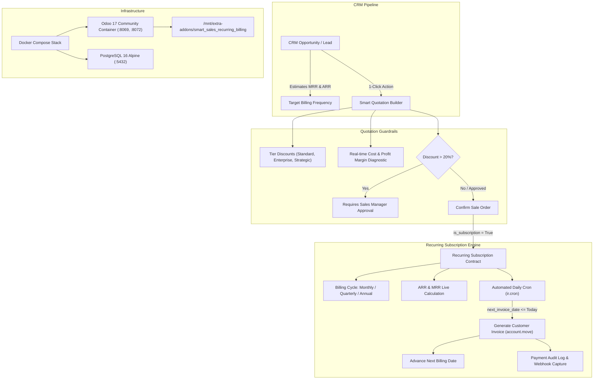

# Odoo 17 Enterprise Sales, CRM & Recurring Subscription Billing Stack

> **A turnkey, containerized Odoo 17 Community & PostgreSQL 16 ERP ecosystem featuring an enterprise custom addon for intelligent quotation building, margin safeguards, automated recurring invoices, ARR/MRR analytics, and payment gateway simulation.**

[](https://www.odoo.com)
[](https://www.postgresql.org)
[](https://docker.com)
[](https://python.org)
[](https://www.gnu.org/licenses/lgpl-3.0.html)

---

## 1. System Architecture



---

## 2. Key Modules & Functional Capabilities

### A. Smart Quotation Builder (`sale.order`)
- **Real-Time Margin Diagnostics**: Aggregates product cost bases (`standard_price`) against custom unit prices, presenting live profit margins with contextual visual badges (green $\ge 30\%$, orange $15-30\%$, red $< 15\%$).
- **Tier-Based Pricing Rules**: One-click pricing rules applying standard, enterprise (10%), or strategic partner (20%) discount baselines.
- **Safety Approval Guardrails**: Prevents confirmation of high-discount quotations ($> 20\%$) unless authorized by a user with the `sales_team.group_sale_manager` role.
- **Seamless Contract Conversion**: Order confirmation automatically instantiates an active `recurring.subscription` contract with line-item mirroring.

### B. Automated Recurring Invoicing Engine (`recurring.subscription`)
- **Flexible Billing Schedules**: Monthly (30 days), Quarterly (90 days), and Annual (365 days).
- **Calendar Progression Algorithms**: Accurate date advancement using Python `dateutil.relativedelta`, handling month-end roll and leap years.
- **Automated Cron Invoicing (`ir.cron`)**: Daily scheduled background job that discovers due subscriptions, creates customer draft/posted invoices (`account.move`), and updates billing schedules.
- **SaaS Revenue Analytics**: Real-time Monthly Recurring Revenue (MRR) and Annual Recurring Revenue (ARR) calculation per customer and across the organization.
- **State Machine Lifecycle**: Full contract governance with `Draft` $\to$ `Active` $\to$ `Paused` $\to$ `Closed/Expired` $\to$ `Cancelled` workflows.

### C. CRM Opportunity Pipeline Integration (`crm.lead`)
- **Recurring Revenue Forecasting**: Captures expected MRR on CRM opportunities, automatically deriving projected ARR (`expected_mrr * 12`).
- **1-Click Quotation Creation**: Direct conversion from qualified opportunities to pre-configured recurring quotations.

### D. Payment Gateway & Transaction Audit (`subscription.payment.log`)
- **Idempotency Protection**: Generates unique cryptographic UUID tokens per transaction to prevent duplicate billing charges.
- **Audit Logs & Retry Mechanism**: Logs gateway reference codes, captures errors, and exposes a manager one-click charge retry action.

### E. Executive QWeb PDF Reports
- Generates customer-facing **Subscription Agreements** detailing recurring terms, cycle fees, and itemized service schedules.

---

## 3. Directory Layout

```
odoo-sales-crm-subscriptions/
├── docker-compose.yml              # Multi-container orchestration (Odoo 17 + PostgreSQL 16)
├── Dockerfile                      # Custom Odoo image with Stripe, Cryptography, Requests
├── .env                            # Environment credentials & port mappings
├── config/
│   └── odoo.conf                   # Tuned production configuration (workers, limits, paths)
├── scripts/
│   └── init_stack.sh               # Turnkey launcher script (start, stop, logs, update, test)
├── custom_addons/
│   └── smart_sales_recurring_billing/
│       ├── __init__.py
│       ├── __manifest__.py         # Odoo 17 manifest with dependencies and metadata
│       ├── models/
│       │   ├── __init__.py
│       │   ├── sale_order.py       # Quotation builder & margin safeguards
│       │   ├── recurring_subscription.py # Subscription engine, ARR/MRR & cron generator
│       │   ├── crm_lead.py         # CRM pipeline ARR/MRR forecasting
│       │   └── payment_transaction_audit.py # Payment logging & retry simulator
│       ├── views/
│       │   ├── sale_order_views.xml
│       │   ├── recurring_subscription_views.xml # Form, Tree, Kanban & Search views
│       │   ├── crm_lead_views.xml
│       │   ├── payment_transaction_views.xml
│       │   └── menus.xml           # Clean navigation structure
│       ├── security/
│       │   ├── res_groups.xml      # User & Manager security groups
│       │   └── ir.model.access.csv # Model CRUD permissions matrix
│       ├── data/
│       │   ├── subscription_sequence.xml # Automatic SUB/2026/0001 sequence
│       │   └── ir_cron_data.xml    # Automated daily invoice generation cron
│       ├── reports/
│       │   └── subscription_report_template.xml # QWeb PDF agreement template
│       └── tests/
│           ├── __init__.py
│           └── test_recurring_billing.py # Odoo TransactionCase unit test suite
├── test_standalone_engine.py       # Standalone Python verification suite (runs without DB)
└── README.md                       # Complete documentation
```

---

## 4. Running the Stack with Docker

### Prerequisites
- Docker engine and Docker Compose installed.

### Turnkey Script Execution

```bash
cd /home/kali/Projects/odoo-sales-crm-subscriptions

# 1. Start the stack (Odoo 17 & PostgreSQL 16)
./scripts/init_stack.sh start

# 2. View live logs
./scripts/init_stack.sh logs

# 3. Update the custom module after code modifications
./scripts/init_stack.sh update-addon smart_sales_recurring_billing odoo_prod

# 4. Run automated tests inside the container
./scripts/init_stack.sh test

# 5. Stop the stack
./scripts/init_stack.sh stop
```

Access the Odoo Web Interface at:
👉 **http://localhost:8069**

Default Master Password: `MasterPass2026!`

---

## 5. Standalone Test Verification

You can verify all XML schemas, business logic, discount rules, date advancement algorithms, and ARR/MRR calculations instantly in any terminal:

```bash
python3 /home/kali/Projects/odoo-sales-crm-subscriptions/test_standalone_engine.py
```

### Verified Test Results:
```
test_xml_files_well_formed: [Pass] Validated 9 Odoo XML files: 100% syntactically well-formed.
test_billing_date_progression: [Pass] Relativedelta calendar progression algorithms verified.
test_high_discount_guardrail: [Pass] High-discount guardrail safety constraint verified.
test_margin_and_tier_pricing: [Pass] Quotation margin and tier pricing logic verified.
test_mrr_arr_normalization: [Pass] MRR & ARR normalization formulas verified.
test_manifest_loads_cleanly: [Pass] Manifest verified (v17.0.1.0.0).

Ran 6 tests in 0.003s — OK
```

---

## 6. Security & Access Control Matrix

| Model | Group | Read | Write | Create | Unlink |
| :--- | :--- | :---: | :---: | :---: | :---: |
| `recurring.subscription` | User / Sales Rep | ✔ | ✔ | ✔ | ✖ |
| `recurring.subscription` | Manager / Admin | ✔ | ✔ | ✔ | ✔ |
| `recurring.subscription.line` | User / Sales Rep | ✔ | ✔ | ✔ | ✖ |
| `recurring.subscription.line` | Manager / Admin | ✔ | ✔ | ✔ | ✔ |
| `subscription.payment.log` | User / Sales Rep | ✔ | ✖ | ✖ | ✖ |
| `subscription.payment.log` | Manager / Admin | ✔ | ✔ | ✔ | ✔ |

Developed by Hamza Ihsan.
